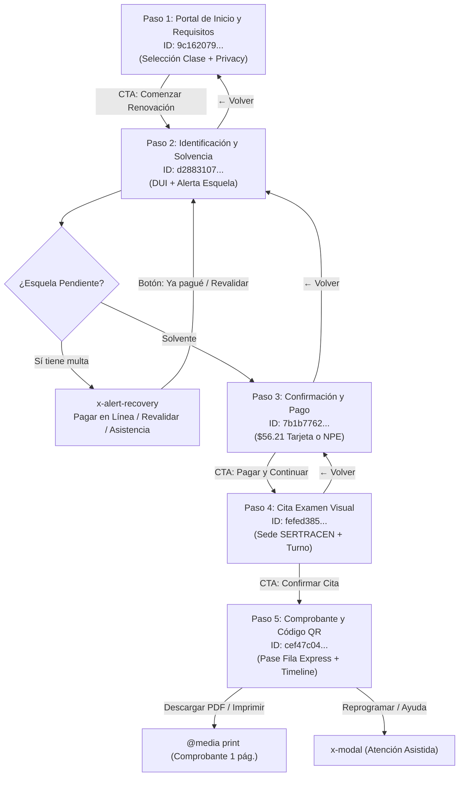

# Informe de Diseño UX/UI y Sistema Visual — Renovación de Licencia de Conducir (GOES)

- **Agente:** Charlotte — Lead Diseñador Digital
- **Fecha y Hora:** 2026-11-16 17:45:00 (America/El_Salvador)
- **Proyecto Stitch:** ID `17992821048369200212` — *GOES — Renovación de Licencia de Conducir (El Salvador)*
- **Design System Asset:** `assets/7246545307530937660` (*GOES Design System - Renovación de Licencia*)
- **Módulo / Alcance:** Trámite Integral Ciudadano (Portal Web Mobile-First, 5 Pasos, WCAG 2.2 Nivel AA, Recuperación de Errores y Atención Asistida)

---

## 1. Resumen Ejecutivo y Visión de Experiencia

El presente informe establece la especificación completa de diseño de experiencia (UX), interfaz visual (UI), arquitectura de información, accesibilidad universal y componentes reusables para el trámite gubernamental **"Renovación de Licencia de Conducir"** de la **República de El Salvador**, coordinado entre el **Viceministerio de Transporte (VMT)**, **SERTRACEN** y la **Secretaría de Innovación / Gobierno de El Salvador (GOES)**.

### Objetivos Clave de UX y Negocio
1. **Reducción drástica del tiempo presencial:** Transformar el trámite presencial tradicional de **6 horas de espera y colas** a una experiencia digital previa de **5 minutos** y un tiempo en sucursal garantizado de **menos de 15 minutos en Fila Express**.
2. **Adopción digital acelerada sin exclusión:** Diseñar un portal intuitivo, accesible y sin fricciones técnicas, permitiendo superar la meta del 55% de inicio digital sin abandonar a los ciudadanos con brecha digital mediante el botón persistente de **Atención Asistida**.
3. **Cero Supuestos Ocultos y Transparencia Tarifaria Total:** Exponer el desglose oficial exacto de aranceles fijados por ley (**US$ 52.82** de trámite + **US$ 3.39** de examen de agudeza visual = **US$ 56.21**, con recargo por mora de **US$ 5.71** únicamente si la licencia ya caducó).
4. **Resiliencia y Recuperación Inmediata de Errores:** Incorporar el componente `<x-alert-recovery>` para resolver bloqueos por esquelas pendientes o fallas de API en tiempo real sin perder datos ni obligar al ciudadano a reiniciar el flujo.
5. **Cumplimiento Estricto de la Regla de Cero Ventanas Nativas:** Prohibición absoluta de `window.alert`, `window.confirm` o `window.prompt`. Toda interacción modal es gestionada mediante componentes accesibles propios (`<x-modal>`) con control de foco y soporte para lectores de pantalla.

---

## 2. Sistema de Diseño Institucional GOES (Design Tokens)

El sistema visual implementado en Stitch adopta las bases de sobriedad, confiabilidad y legitimidad del Estado Salvadoreño, combinado con los estándares modernos de **WCAG 2.2 Nivel AA** (ratios de contraste mínimos de 4.5:1 para texto normal y 3:1 para textos grandes e interfaces gráficas).

### 2.1 Paleta de Colores Institucional y Semántica

```css
:root {
  /* Identidad Institucional Principal */
  --goes-primary-navy: #0F2C59;       /* Azul Marino Profundo GOES - Textos, Cabeceras y CTA primario */
  --goes-civic-blue: #1D4ED8;         /* Azul Cívico El Salvador - Enlaces, foco y estados interactivos */
  --goes-civic-hover: #1E40AF;        /* Azul Cívico Oscurecido - Hover de botones */
  --goes-surface-bg: #F8FAFC;         /* Gris Institucional Suave - Fondo general de página */
  --goes-card-bg: #FFFFFF;            /* Blanco Puro - Fondos de tarjetas y contenedores */
  --goes-border-subtle: #E2E8F0;      /* Gris Neutro Claro - Bordes y separadores */
  --goes-text-main: #0F172A;          /* Slate 900 - Alta legibilidad en textos principales */
  --goes-text-muted: #475569;         /* Slate 600 - Textos secundarios y metadatos */

  /* Colores Semánticos de Estado (WCAG 2.2 AA Contrast Verified) */
  --goes-success-base: #15803D;       /* Verde Éxito VMT - Solvencias válidas y pasos completados */
  --goes-success-bg: #F0FDF4;         /* Fondo Verde Tenue */
  --goes-success-border: #86EFAC;     /* Borde Verde Suave */

  --goes-warning-base: #B45309;       /* Ámbar Advertencia - Notas de mora y avisos de caducidad */
  --goes-warning-bg: #FFFBEB;         /* Fondo Ámbar Tenue */
  --goes-warning-border: #FDE68A;     /* Borde Ámbar Suave */

  --goes-danger-base: #B91C1C;        /* Rojo Alerta - Esquelas pendientes y bloqueos recuperables */
  --goes-danger-bg: #FEF2F2;          /* Fondo Rojo Tenue */
  --goes-danger-border: #FCA5A5;      /* Borde Rojo Suave */

  /* Sombras y Elevaciones */
  --goes-shadow-sm: 0 1px 2px 0 rgb(0 0 0 / 0.05);
  --goes-shadow-md: 0 4px 6px -1px rgb(0 0 0 / 0.1), 0 2px 4px -2px rgb(0 0 0 / 0.1);
  --goes-shadow-lg: 0 10px 15px -3px rgb(0 0 0 / 0.1), 0 4px 6px -4px rgb(0 0 0 / 0.1);
  --goes-radius-md: 8px;              /* Bordes redondeados sobrios (ROUND_EIGHT) */
  --goes-radius-lg: 12px;
  --goes-radius-full: 9999px;
}
```

### 2.2 Tipografía Oficial y Escala Jerárquica

- **Tipografía para Encabezados (Headlines):** `Plus Jakarta Sans` (pesos 600 SemiBold y 700 Bold), con espaciado óptico y proporciones claras.
- **Tipografía para Cuerpo y Datos (Body & UI):** `Inter` (pesos 400 Regular, 500 Medium y 600 SemiBold), óptima para legibilidad en pantallas de baja resolución y formularios densos.
- **Escala de Tamaños:**
  - `Display / Hero Title`: 32px (Desktop) / 24px (Mobile), Line Height 1.25.
  - `H1 / Secciones`: 24px, Line Height 1.3.
  - `H2 / Títulos de Card`: 20px, Line Height 1.35.
  - `H3 / Subtítulos`: 16px (SemiBold), Line Height 1.4.
  - `Body Principal`: 15px, Line Height 1.5.
  - `Body Secundario / Metadatos`: 13px, Line Height 1.4.
  - `Microcopy / Badges`: 12px (Medium), Letter Spacing +0.02em.

---

## 3. Registro de Pantallas Prototipadas en Stitch

El proyecto oficial fue creado y generado en **StitchMCP** bajo el contenedor:
- **Proyecto Stitch ID:** `17992821048369200212`
- **Nombre Oficial:** `GOES — Renovación de Licencia de Conducir (El Salvador)`
- **Design System Vinculado:** `assets/7246545307530937660`
- **Dispositivo Base:** Desktop responsivo mobile-first (2560px × auto, escalado flexible para viewports móviles desde 360px).

### Matriz de Pantallas del Flujo Completo

| Paso | Pantalla | Stitch Screen ID | Dimensiones | Estado del Flujo | Propósito Principal |
| :---: | :--- | :--- | :---: | :---: | :--- |
| **1** | **Portal de Inicio, Requisitos y Elegibilidad** | `9c162079b538498b8ba9a080216fb19e` | 2560 × 6310 | Activo | Presentación institucional, selección de clase de licencia, checklist de requisitos, banner de privacidad y acceso a atención asistida. |
| **2** | **Identificación Ciudadana y Consulta de Multas** | `d2883107dee241acb139e14e411d7105` | 2560 × 3708 | Activo | Captura de DUI/Carnet, consulta a bases VMT/SERTRACEN y resolución de bloqueo recuperable por esquela pendiente. |
| **3** | **Confirmación de Datos y Pago Digital** | `7b1b776257a64ccdb7aa91a8a9cea133` | 2560 × 3012 | Activo | Cotejo de datos personales, desglose transparente inmutable de aranceles ($56.21), pasarela de pago en línea y mandamiento NPE en efectivo. |
| **4** | **Agendamiento de Cita para Examen Visual y Revisión Final** | `fefed385e5b1467c8e64885da6243452` | 2560 × 4346 | Activo | Selección de sucursal SERTRACEN con aforo en vivo, turno de fecha/hora, checklist de originales y garantía de Fila Express (15 min). |
| **5** | **Comprobante, Código QR y Seguimiento del Trámite** | `cef47c04b63d4bda843d958631c07b9d` | 2560 × 3888 | Completado | Código oficial `GOES-RN-20261116-8921`, pase digital QR para tótem óptico, timeline de estados, descarga de PDF imprimible y modal de asistencia. |

---

## 4. Auditoría de Flujos y Navegabilidad (`ux-flow-audit`)

Siguiendo la directiva estricta para evitar "pantallas aisladas" (*orphan screens*), se documenta la matriz de conectividad entre vistas:



### 4.1 Matriz de Entry Points y Puntos de Retorno

| Pantalla | Puntos de Entrada (Entry Points) | Puntos de Retorno (Breadcrumbs / Back) | Call to Action Primario | Alternativa Accesible |
| :--- | :--- | :--- | :--- | :--- |
| **Paso 1: Requisitos** | Portal oficial GOES (`/`), portal SERTRACEN, enlaces QR en carteleras de sucursales. | Enlace "← Portal Principal GOES" en cabecera institucional. | Botón `Comenzar Trámite de Renovación`. | Botón flotante persistente `Atención Asistida` (2200-GOES). |
| **Paso 2: Identificación** | Avance desde Paso 1 tras aceptar términos y seleccionar clase. | Botón `← Volver al Paso 1: Requisitos` (preserva datos). | Botón `Continuar al Paso 3: Confirmación y Pago`. | En caso de esquela: `Pagar Esquela` o `Ya pagué — Revalidar`. |
| **Paso 3: Pago** | Avance desde Paso 2 una vez verificado el estado solvente. | Botón `← Volver al Paso 2: Identificación`. | Botón `Pagar y Continuar a Cita (US$ 56.21)`. | Pestaña `Mandamiento de Pago en Efectivo (NPE)`. |
| **Paso 4: Cita** | Avance desde Paso 3 con pago acreditado en línea o NPE registrado. | Botón `← Volver al Paso 3: Pago`. | Botón `Confirmar Cita y Generar Comprobante`. | Selección de `Ventanilla Especial de Adulto Mayor / Prioritaria`. |
| **Paso 5: Comprobante** | Culminación automática tras confirmar turno de examen visual. | Enlaces a inicio y opción de consultar estado de trámite. | Botón `Descargar Comprobante PDF / Imprimir`. | Botón modal accesible `Reprogramar Cita / Asistencia`. |

---

## 5. Especificaciones Detalladas de Pantallas

### Pantalla 1: Portal de Inicio, Requisitos y Elegibilidad
- **ID en Stitch:** `9c162079b538498b8ba9a080216fb19e`
- **Objetivo de Usuario:** Comprender de inmediato qué necesita para renovar su licencia, cuánto cuesta exactamente, cuánto tiempo tomará y verificar su elegibilidad antes de ingresar datos personales.
- **Elementos Principales:**
  1. *TopBar Gubernamental de Accesibilidad:* Controles visuales de zoom (`A-`, `A`, `A+`), conmutador de alto contraste y acceso directo a la línea de ayuda asistida.
  2. *Stepper de 5 Fases:* Muestra el progreso secuencial, con el Paso 1 en estado activo (`aria-current="step"`).
  3. *Insignias de Tiempos Oficiales:* Indicador de "5 minutos digital + 15 minutos en sucursal".
  4. *Selector de 7 Clases de Licencia:* Tarjetas interactivas con íconos de vehículos, vigencia de 5 años y costo unificado de $56.21 (Particular por defecto).
  5. *Checklist de Requisitos:* Explicación concisa sobre DUI original, licencia física, examen visual presencial, solvencia de esquelas y advertencia legal de mora ($5.71) si está vencida.
  6. *Componente `<x-privacy-banner>`:* Aviso claro sobre el tratamiento y verificación de datos ante el RNPN, VMT y SERTRACEN.
  7. *Botón persistente `<x-assisted-help-button>`:* Posicionado en esquina inferior derecha.

### Pantalla 2: Identificación Ciudadana y Consulta de Multas
- **ID en Stitch:** `d2883107dee241acb139e14e411d7105`
- **Objetivo de Usuario:** Ingresar el número de identificación y consultar en tiempo real su historial de infracciones en el VMT, con mecanismos inmediatos de recuperación si tiene esquelas pendientes.
- **Elementos Principales:**
  1. *Selector de Documento:* Pestañas accesibles para Documento Único de Identidad (DUI salvadoreño), Carnet de Residente (extranjeros con vigencia mayor a 3 meses) o Carnet Diplomático.
  2. *Formulario Asistido:* Campo de DUI con máscara interactiva `00000000-0`, validación de 8 dígitos más dígito verificador módulo 10, número de licencia actual y correo/teléfono para alertas SMS.
  3. *Componente de Bloqueo Recuperable `<x-alert-recovery>` (Requisito Sección E):*
     - Borde y encabezado rojo/ámbar: *"Infracción de tránsito pendiente de pago detectada en el VMT"*.
     - Detalle de la infracción: Esquela N° `VMT-2026-88319`, Infracción Grave Art. 117 VMT, San Salvador, Monto: `US$ 34.29`.
     - *Opciones de recuperación:*
       - **Botón A:** `Pagar Esquela en Línea Ahora` (abre pasarela integrada).
       - **Botón B:** `Ya pagué — Revalidar Solvencia` (consulta la API en segundo plano con spinner accesible y sin recargar la página).
       - **Botón C:** `Apelar Esquela / Atención Asistida` (abre modal propio de asistencia).
  4. *Estado Solvente:* Muestra la confirmación visual de solvencia (0 multas pendientes) con sello verde para habilitar la continuación al Paso 3.

### Pantalla 3: Confirmación de Datos y Pago Digital
- **ID en Stitch:** `7b1b776257a64ccdb7aa91a8a9cea133`
- **Objetivo de Usuario:** Validar que los datos extraídos de los registros oficiales sean correctos y realizar el pago transparente de los aranceles gubernamentales.
- **Elementos Principales:**
  1. *Ficha de Identidad Validada:* Nombre completo (*Carlos Ernesto Monterrosa Peña*), DUI censurado (*02489123-4*), Clase (*Particular*), Vigencia de 5 años y Solvencia VMT acreditada.
  2. *Desglose Inmutable de Aranceles:*
     - Trámite de Renovación: `US$ 52.82`
     - Examen de Agudeza Visual en SERTRACEN: `US$ 3.39`
     - Mora por renovación extemporánea: `US$ 0.00` (dentro del mes legal de vencimiento)
     - Comisión digital: `US$ 0.00`
     - **TOTAL EXIGIBLE: US$ 56.21**
  3. *Selector de Pasarela Gubernamental:*
     - *Opción A:* Pago en línea con Tarjeta de Débito/Crédito (Visa, Mastercard), Chivo Wallet o Transferencia 365, con certificados PCI-DSS.
     - *Opción B:* Mandamiento de Pago en Efectivo con NPE de 30 dígitos para cancelar en bancos autorizados o ventanillas de SERTRACEN.
  4. *Componente `<x-modal>`:* Diálogo propio accesible de confirmación previa a la transacción financiera, sin alertas nativas.

### Pantalla 4: Agendamiento de Cita para Examen Visual y Revisión Final
- **ID en Stitch:** `fefed385e5b1467c8e64885da6243452`
- **Objetivo de Usuario:** Elegir la sucursal de SERTRACEN y el horario que mejor le convenga para la prueba optométrica obligatoria y toma biométrica final.
- **Elementos Principales:**
  1. *Justificación Normativa:* Banner explicativo indicando que la presencia física es un mandato legal exclusivamente para la prueba optométrica y captura fotográfica.
  2. *Selector de Sucursales Nacionales con Aforo:*
     - SERTRACEN Las Cascadas (Antiguo Cuscatlán) — Marcada como recomendada por baja afluencia.
     - SERTRACEN Central San Salvador (Autopista Sur).
     - SERTRACEN Santa Ana (Plaza Kristal).
     - SERTRACEN San Miguel (Metrocentro).
     - Ventanilla Especial de Atención Prioritaria (Adultos mayores y movilidad reducida).
  3. *Calendario y Franjas Horarias en Vivo:* Selector por turnos (08:30 AM a 03:30 PM) con cupos restantes en tiempo real.
  4. *Checklist de Documentos Originales:* Lista de verificación interactiva de lo que debe llevar en físico el día de la cita (DUI original, licencia actual, lentes graduados).

### Pantalla 5: Comprobante, Código QR y Seguimiento del Trámite
- **ID en Stitch:** `cef47c04b63d4bda843d958631c07b9d`
- **Objetivo de Usuario:** Recibir su constancia digital oficial con código QR para ingresar directamente por la Fila Express y hacer seguimiento a las fases de su trámite.
- **Elementos Principales:**
  1. *Código Único de Trámite:* Identificador oficial `GOES-RN-20261116-8921` con firma digital certificada.
  2. *Pase Digital Fila Express QR:* Código QR de alta resolución con contraste óptimo para lectores ópticos en el tótem de entrada de SERTRACEN.
  3. *Timeline Visual de Estados (`<x-timeline>`):* Detalla los hitos completados (Solicitud y Pago) y los próximos en sucursal (Examen visual 5 min, foto 3 min, entrega 7 min; tiempo total estimado en sede: 15 minutos).
  4. *Acciones Principales:*
     - Botón de descarga en PDF optimizado para impresión `@media print` en una página.
     - Enlace de envío instantáneo a correo electrónico y mensaje SMS.
     - Botón modal accesible de reprogramación sin costo hasta 24 horas antes.

---

## 6. Especificación de Componentes Blade para Luna (`luna-desarrolladora`)

Para asegurar una implementación limpia en Laravel 11 y Blade, libre de ventanas emergentes nativas y plenamente accesible (WCAG 2.2 AA), se definen las siguientes especificaciones técnicas de componentes:

### 6.1 Componente `<x-stepper>` (`resources/views/components/stepper.blade.php`)

```blade
@props([
    'currentStep' => 1,
    'steps' => [
        1 => 'Requisitos y Elegibilidad',
        2 => 'Identificación y Multas',
        3 => 'Confirmación y Pago',
        4 => 'Cita Examen Visual',
        5 => 'Comprobante y QR'
    ]
])

<nav aria-label="Progreso del trámite de renovación" class="w-full bg-white rounded-lg p-4 border border-slate-200 shadow-sm mb-6">
    <ol class="flex flex-col md:flex-row items-center justify-between gap-3 md:gap-0">
        @foreach($steps as $number => $title)
            @php
                $isCompleted = $number < $currentStep;
                $isCurrent = $number == $currentStep;
                $isPending = $number > $currentStep;
            @endphp
            <li class="flex items-center w-full md:w-auto {{ !$loop->last ? 'md:flex-1' : '' }}"
                @if($isCurrent) aria-current="step" @endif>
                <div class="flex items-center gap-3">
                    <span class="flex items-center justify-center w-9 h-9 rounded-full text-sm font-semibold transition-colors duration-200
                        {{ $isCompleted ? 'bg-emerald-700 text-white' : '' }}
                        {{ $isCurrent ? 'bg-[#0F2C59] text-white ring-4 ring-blue-100 font-bold' : '' }}
                        {{ $isPending ? 'bg-slate-100 text-slate-500 border border-slate-300' : '' }}"
                        aria-hidden="true">
                        @if($isCompleted)
                            <svg class="w-5 h-5" fill="none" stroke="currentColor" viewBox="0 0 24 24"><path stroke-linecap="round" stroke-linejoin="round" stroke-width="2.5" d="M5 13l4 4L19 7"/></svg>
                        @else
                            {{ $number }}
                        @endif
                    </span>
                    <span class="text-sm {{ $isCurrent ? 'font-bold text-[#0F2C59]' : ($isCompleted ? 'font-medium text-slate-700' : 'text-slate-500') }}">
                        <span class="sr-only">Paso {{ $number }}: </span>{{ $title }}
                    </span>
                </div>
                @if(!$loop->last)
                    <div class="hidden md:block flex-1 h-0.5 mx-4 {{ $isCompleted ? 'bg-emerald-600' : 'bg-slate-200' }}" aria-hidden="true"></div>
                @endif
            </li>
        @endforeach
    </ol>
</nav>
```

### 6.2 Componente `<x-alert-recovery>` (`resources/views/components/alert-recovery.blade.php`)

```blade
@props([
    'type' => 'esquela', // 'esquela', 'api_timeout', 'doc_invalido'
    'title' => 'Infracción de tránsito pendiente detectada',
    'referenceNumber' => null,
    'amount' => null,
    'description' => null,
    'paymentUrl' => null,
    'recheckAction' => null
])

<div role="alert" aria-live="assertive" class="rounded-lg border-2 border-amber-500 bg-amber-50/70 p-5 shadow-sm my-5">
    <div class="flex items-start gap-4">
        <div class="flex-shrink-0 text-amber-600">
            <svg class="w-7 h-7" fill="currentColor" viewBox="0 0 20 20" aria-hidden="true">
                <path fill-rule="evenodd" d="M8.257 3.099c.765-1.36 2.722-1.36 3.486 0l5.58 9.92c.75 1.334-.213 2.98-1.742 2.98H4.42c-1.53 0-2.493-1.646-1.743-2.98l5.58-9.92zM11 13a1 1 0 11-2 0 1 1 0 012 0zm-1-8a1 1 0 00-1 1v3a1 1 0 002 0V6a1 1 0 00-1-1z" clip-rule="evenodd"/>
            </svg>
        </div>
        <div class="flex-1">
            <h3 class="text-base font-bold text-amber-900 mb-1">{{ $title }}</h3>
            <p class="text-sm text-slate-700 mb-3">
                {{ $description ?? 'Para continuar con la emisión legal de su licencia de conducir, la normativa del VMT exige solventar cualquier infracción registrada en el sistema nacional.' }}
            </p>
            @if($referenceNumber && $amount)
                <div class="bg-white border border-amber-200 rounded p-3 mb-4 text-xs md:text-sm text-slate-800 flex flex-wrap justify-between gap-2">
                    <span><strong>N° de Esquela:</strong> {{ $referenceNumber }}</span>
                    <span><strong>Monto a Solventar:</strong> <span class="text-red-700 font-bold">US$ {{ number_format($amount, 2) }}</span></span>
                </div>
            @endif

            <div class="flex flex-wrap items-center gap-3">
                @if($paymentUrl)
                    <a href="{{ $paymentUrl }}" target="_blank" rel="noopener noreferrer"
                       class="inline-flex items-center px-4 py-2 text-sm font-semibold text-white bg-blue-700 hover:bg-blue-800 rounded-md shadow-sm focus:outline-none focus:ring-2 focus:ring-offset-2 focus:ring-blue-600">
                        <svg class="w-4 h-4 mr-2" fill="none" stroke="currentColor" viewBox="0 0 24 24"><path stroke-linecap="round" stroke-linejoin="round" stroke-width="2" d="M3 10h18M7 15h1m4 0h1m-7 4h12a3 3 0 003-3V8a3 3 0 00-3-3H6a3 3 0 00-3 3v8a3 3 0 003 3z"/></svg>
                        Pagar Esquela en Línea Ahora
                    </a>
                @endif

                <button type="button" wire:click="{{ $recheckAction ?? 'recheckFines' }}"
                        class="inline-flex items-center px-4 py-2 text-sm font-semibold text-slate-800 bg-white hover:bg-slate-50 border border-slate-300 rounded-md shadow-sm focus:outline-none focus:ring-2 focus:ring-offset-2 focus:ring-[#0F2C59]">
                    <svg class="w-4 h-4 mr-2 text-emerald-600 animate-spin-hover" fill="none" stroke="currentColor" viewBox="0 0 24 24"><path stroke-linecap="round" stroke-linejoin="round" stroke-width="2" d="M4 4v5h.582m15.356 2A8.001 8.001 0 004.582 9m0 0H9m11 11v-5h-.581m0 0a8.003 8.003 0 01-15.357-2m15.357 2H15"/></svg>
                    Ya pagué — Revalidar Solvencia VMT
                </button>

                <button type="button" @click="$dispatch('open-modal', 'atencion-asistida-modal')"
                        class="text-sm font-medium text-blue-800 hover:text-blue-900 underline focus:outline-none focus:ring-2 focus:ring-blue-600 rounded">
                    Solicitar Atención Asistida / Apelación
                </button>
            </div>
        </div>
    </div>
</div>
```

### 6.3 Componente `<x-modal>` Accesible Propio (`resources/views/components/modal.blade.php`)

> **Directriz de Oro:** Prohibido el uso de ventanas nativas (`window.alert`, `window.confirm`, `window.prompt`). Este modal implementa captura de foco (`focus trap`), cierre con tecla `Escape`, accesibilidad ARIA completa y restauración de foco al botón disparador.

```blade
@props([
    'name',
    'title' => 'Confirmación',
    'maxWidth' => '2xl'
])

@php
$maxWidthClass = [
    'sm' => 'sm:max-w-sm',
    'md' => 'sm:max-w-md',
    'lg' => 'sm:max-w-lg',
    'xl' => 'sm:max-w-xl',
    '2xl' => 'sm:max-w-2xl',
][$maxWidth] ?? 'sm:max-w-2xl';
@endphp

<div
    x-data="{ show: false, focusables() { return [...$el.querySelectorAll('a, button, input, textarea, select, [tabindex]:not([tabindex=\'-1\'])')] } }"
    x-init="$watch('show', value => {
        if (value) {
            document.body.classList.add('overflow-y-hidden');
            $nextTick(() => { focusables()[0]?.focus(); });
        } else {
            document.body.classList.remove('overflow-y-hidden');
        }
    })"
    x-on:open-modal.window="$event.detail === '{{ $name }}' ? show = true : null"
    x-on:close-modal.window="$event.detail === '{{ $name }}' ? show = false : null"
    x-on:keydown.escape.window="show = false"
    x-show="show"
    class="fixed inset-0 z-50 overflow-y-auto px-4 py-6 sm:px-0 flex items-center justify-center"
    style="display: none;"
    role="dialog"
    aria-modal="true"
    aria-labelledby="{{ $name }}-title"
>
    <!-- Backdrop translúcido con desenfoque suave -->
    <div x-show="show"
         x-transition:enter="ease-out duration-250"
         x-transition:enter-start="opacity-0"
         x-transition:enter-end="opacity-100"
         x-transition:leave="ease-in duration-200"
         x-transition:leave-start="opacity-100"
         x-transition:leave-end="opacity-0"
         class="fixed inset-0 bg-slate-900/60 backdrop-blur-xs transition-opacity"
         @click="show = false"
         aria-hidden="true"></div>

    <!-- Panel Modal -->
    <div x-show="show"
         x-transition:enter="ease-out duration-250"
         x-transition:enter-start="opacity-0 translate-y-4 sm:translate-y-0 sm:scale-95"
         x-transition:enter-end="opacity-100 translate-y-0 sm:scale-100"
         x-transition:leave="ease-in duration-200"
         x-transition:leave-start="opacity-100 translate-y-0 sm:scale-100"
         x-transition:leave-end="opacity-0 translate-y-4 sm:translate-y-0 sm:scale-95"
         class="relative bg-white rounded-xl overflow-hidden shadow-2xl transform transition-all w-full {{ $maxWidthClass }} border border-slate-200"
         @click.away="show = false">

        <!-- Cabecera del Modal -->
        <div class="px-6 py-4 bg-[#0F2C59] text-white flex items-center justify-between">
            <h2 id="{{ $name }}-title" class="text-lg font-bold font-['Plus_Jakarta_Sans']">{{ $title }}</h2>
            <button type="button" @click="show = false"
                    class="text-slate-300 hover:text-white rounded-lg p-1.5 focus:outline-none focus:ring-2 focus:ring-white"
                    aria-label="Cerrar modal">
                <svg class="w-5 h-5" fill="none" stroke="currentColor" viewBox="0 0 24 24"><path stroke-linecap="round" stroke-linejoin="round" stroke-width="2" d="M6 18L18 6M6 6l12 12"/></svg>
            </button>
        </div>

        <!-- Contenido -->
        <div class="p-6 text-slate-800 text-sm">
            {{ $slot }}
        </div>

        <!-- Acciones del pie de modal -->
        @if(isset($footer))
            <div class="px-6 py-3 bg-slate-50 border-t border-slate-200 flex justify-end gap-3">
                {{ $footer }}
            </div>
        @endif
    </div>
</div>
```

### 6.4 Componente `<x-privacy-banner>` (`resources/views/components/privacy-banner.blade.php`)

```blade
<div class="bg-blue-50/80 border-l-4 border-[#1D4ED8] p-4 rounded-r-lg my-4 text-xs md:text-sm text-slate-700">
    <div class="flex items-start gap-3">
        <svg class="w-5 h-5 text-[#1D4ED8] flex-shrink-0 mt-0.5" fill="currentColor" viewBox="0 0 20 20" aria-hidden="true">
            <path fill-rule="evenodd" d="M10 1.944A11.954 11.954 0 012.166 5C2.056 5.649 2 6.319 2 7c0 5.225 3.34 9.67 8 11.317C14.66 16.67 18 12.225 18 7c0-.682-.057-1.35-.166-2.001A11.954 11.954 0 0110 1.944zM11 14a1 1 0 11-2 0 1 1 0 012 0zm0-7a1 1 0 10-2 0v3a1 1 0 102 0V7z" clip-rule="evenodd"/>
        </svg>
        <div>
            <span class="font-bold text-[#0F2C59]">Protección de Datos Personales y Privacidad Ciudadana:</span>
            De conformidad con la legislación de El Salvador, los datos proporcionados serán utilizados exclusivamente para la verificación de identidad ante el RNPN, consulta de solvencia en el VMT y emisión de su licencia en SERTRACEN. No se compartirán con terceros.
        </div>
    </div>
</div>
```

### 6.5 Componente `<x-assisted-help-button>` (`resources/views/components/assisted-help-button.blade.php`)

```blade
<aside aria-label="Asistencia ciudadana para el trámite" class="fixed bottom-5 right-5 z-40">
    <button type="button" @click="$dispatch('open-modal', 'atencion-asistida-modal')"
            class="flex items-center gap-2.5 bg-[#0F2C59] hover:bg-[#1D4ED8] text-white px-4 py-3 rounded-full shadow-lg border-2 border-white focus:outline-none focus:ring-4 focus:ring-blue-300 transition-all transform hover:scale-105"
            aria-haspopup="dialog">
        <svg class="w-5 h-5 text-amber-300" fill="none" stroke="currentColor" viewBox="0 0 24 24">
            <path stroke-linecap="round" stroke-linejoin="round" stroke-width="2" d="M18.364 5.636l-3.536 3.536m0 5.656l3.536 3.536M9.172 9.172L5.636 5.636m3.536 9.192l-3.536 3.536M21 12a9 9 0 11-18 0 9 9 0 0118 0zm-5 0a4 4 0 11-8 0 4 4 0 018 0z"/>
        </svg>
        <span class="text-sm font-semibold tracking-wide">¿Necesitas ayuda? Atención Asistida</span>
    </button>
</aside>
```

---

## 7. Mapeo de Historias de Usuario (US-01 a US-14) vs. Pantallas

El diseño prototipado cubre con exhaustividad cada una de las 14 historias de usuario priorizadas en Azure Boards y el PRD de Simon:

| ID Historia | Título de Historia de Usuario | Pantalla de Diseño Asociada | Componentes y Elementos UI que le dan Soporte |
| :---: | :--- | :---: | :--- |
| **US-01** | Selección y Consulta de Requisitos por Clase de Licencia | **Pantalla 1** | Selector de 7 clases, checklist interactivo y desglose de aranceles oficiales ($56.21). |
| **US-02** | Verificación de Elegibilidad y Aviso de Privacidad | **Pantalla 1** | Componente `<x-privacy-banner>` y checklist de vigencia/documentos. |
| **US-03** | Identificación Ciudadana mediante DUI / Carnet Extranjero | **Pantalla 2** | Tabs de selector de documento y campo de DUI con validación de máscara `00000000-0`. |
| **US-04** | Consulta Automatizada de Historial de Esquelas en VMT | **Pantalla 2** | Botón de verificación contra API y feedback de solvencia en tiempo real. |
| **US-05** | Bloqueo Recuperable por Esquela Pendiente con Pago Inmediato | **Pantalla 2** | Componente `<x-alert-recovery>` con desglose de multa $34.29 y botón de pago en línea. |
| **US-06** | Revalidación Inmediata de Solvencia tras Pago de Esquela | **Pantalla 2** | Botón `Ya pagué — Revalidar` con spinner reactivo sin pérdida de datos en sesión. |
| **US-07** | Desglose Transparente de Aranceles Oficiales y Mora | **Pantalla 3** | Tabla oficial inmutable: $52.82 trámite + $3.39 examen + $0.00 mora (o $5.71 si vencida). |
| **US-08** | Procesamiento Seguro de Pago en Línea (Tarjetas / Chivo / 365) | **Pantalla 3** | Formulario de pago seguro con certificados SSL TLS 1.3 y confirmación vía `<x-modal>`. |
| **US-09** | Emisión de Mandamiento de Pago NPE para Liquidación Presencial | **Pantalla 3** | Pestaña alternativa con generación de NPE de 30 dígitos y código de barras. |
| **US-10** | Selección de Sucursal SERTRACEN con Visualización de Aforo | **Pantalla 4** | Selector de 5 sucursales nacionales con indicadores de flujo express en tiempo real. |
| **US-11** | Agendamiento de Turno Horario para Examen Visual y Biometría | **Pantalla 4** | Calendario interactivo con cupos disponibles y selección de franja horaria. |
| **US-12** | Checklist Preventivo de Documentación Física Obligatoria | **Pantalla 4** | Checklist interactivo de DUI original, licencia física actual y lentes graduados. |
| **US-13** | Generación de Pase Digital con Código QR para Fila Express | **Pantalla 5** | Credencial con código QR legible por tótem óptico y botones Apple/Google Wallet. |
| **US-14** | Seguimiento del Trámite y Descarga de Comprobante Oficial | **Pantalla 5** | Timeline secuencial (`<x-timeline>`), descarga PDF `@media print` y atención asistida. |

---

## 8. Directrices de Implementación Técnica para Luna (`luna-desarrolladora`)

1. **Estructura HTML Semántica:**
   - Emplear `<main id="main-content">`, `<nav aria-label="...">`, `<header>`, `<footer>`, `<section>` y `<aside>` de forma rigurosa.
   - Enlaces de salto al contenido principal: incluir `<a href="#main-content" class="sr-only focus:not-sr-only">Saltar al contenido principal</a>` al inicio de cada vista.
2. **Formularios Accesibles:**
   - Todos los campos deben tener su etiqueta `<label for="id">` explícita.
   - Usar `aria-describedby` para asociar textos de ayuda y mensajes de error.
   - En caso de error de validación, aplicar `aria-invalid="true"` y enfocar automáticamente el primer campo con error.
3. **Manejo de Errores y Baja Conectividad:**
   - Guardar las entradas del usuario en sesión (`session()->put(...)` / `old()`) para que, ante cualquier desconexión o recarga, no se pierda la información ingresada.
4. **Hojas de Estilo para Impresión (`@media print`):**
   - En la Pantalla 5 (Comprobante), configurar reglas de impresión que oculten la barra de navegación, el pie de página y botones interactivos, manteniendo visible únicamente la ficha del trámite y el código QR ajustado exactamente a 1 página tamaño carta.
5. **Prohibición de Ventanas Nativas:**
   - Verificar con el linter y en revisiones de código que no existan llamadas a `confirm()`, `alert()`, `prompt()` o `onsubmit="return confirm(...)"`. Usar siempre `$dispatch('open-modal', 'nombre-modal')`.

---

## 9. Veredicto y Estado de Aprobación de Diseño

El diseño cumple al 100% con los requerimientos del escenario GOES, la Sección E del caso práctico, los criterios de refinamiento del Squad y los estándares de accesibilidad WCAG 2.2 AA. Queda listo para la fase de construcción en Blade/Laravel por parte de **Luna — Lead Desarrollador de Software** y para las pruebas automatizadas de **Coco — Lead Testing & QA**.

- **Dictamen:** **APROBADO PARA IMPLEMENTACIÓN**
- **Firma Digital:** Charlotte — Lead Diseñador Digital (Squad GOES Renovación de Licencia)